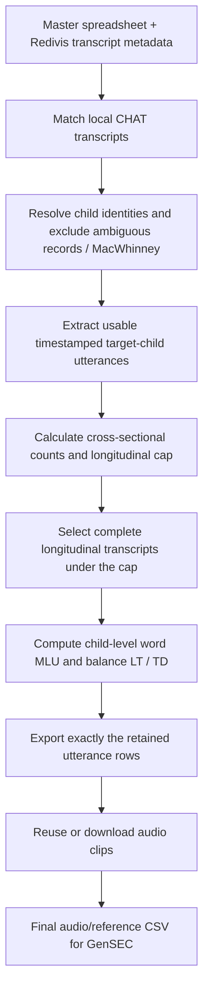

# CHILDES ASR dataset pipeline

Build a reproducible child-speech dataset from a TalkBank search export, Redivis
transcript metadata, CHAT archives and linked TalkBank media.



## Setup and inputs

Create the environment, including ffmpeg:

```powershell
conda env create -f envs/environment.yml
conda activate asr-dataset-pipelines
```

1. Export a [TalkBank CHILDES search](https://talkbank.org/0info/DB/) to
   `data/childes_talkbank_master_file.xlsx`. The study's search used English,
   Clinical-Eng/Eng-NA/Eng-UK, ages 60–108 months and TD/LT/SLI groups.
   Positional exports and the named columns in `config.py:SOURCE_COLUMNS`
   are supported. This workbook selects recordings; its ID column is preserved
   as `manifest_new_id`, not trusted as speaker identity.
2. Download the relevant corpus transcript ZIPs from TalkBank and place them
   in `data/transcripts/<Corpus>.zip`. Extraction runs before preprocessing;
   already extracted directories are reused.
3. Grant your Redivis account data access to `datapages/childes-db`. The first
   uncached run retrieves the `transcript` table with interactive Redivis login.
   Later runs reuse `data/raw/redivis_transcripts.csv`. Use `--refresh-data`
   to refresh that metadata. The old multi-GB utterance cache is not needed:
   the authoritative utterance text, timestamps and word counts come from CHAT.
4. For new media, sign into TalkBank when Chrome opens or supply exported
   cookies with `--cookies-file`. Original transcript archives are never deleted.

TalkBank access and corpus restrictions still apply. Consult the
[access levels](https://talkbank.org/childes/access.html),
[ground rules](https://talkbank.org/0share/rules.html) and
[citation requirements](https://talkbank.org/0share/citation.html).

## Run

```powershell
python src/main.py
python src/main.py --cookies-file path/to/cookies.json
python src/main.py --reuse-only
```

`--reuse-only` performs the full selection/export using existing local audio,
without browser login or network access. It returns exit code 2 if selected
clips are missing; missing rows have no usable audio path and cannot enter GenSEC.
Rerun normally with TalkBank access to complete them. Existing clips are reused
at their existing paths; canonical child identities are stored in metadata.
Old clips and folders remain intact; only report rows define the current dataset.

The cap settings are explicit and configurable:

```powershell
python src/main.py --cap-center mean --cap-sd 3 --seed 42
python src/main.py --cap-center median --cap-sd 3 --seed 42
```

Default: `floor(cross-sectional mean + 3 × cross-sectional sample SD)`.
The meeting did not settle mean versus median; mean is the configurable
implementation default. The actual threshold is calculated for each run,
never copied from an illustrative example.

Individual stages:

```powershell
python src/preprocessing_pipeline/main.py
python src/media_pipeline/main.py --reuse-only
python -m unittest discover -s tests -v
```

## Child identity

Child IDs are strings, namespaced by corpus. Recording IDs, source PIDs and
original master IDs remain available separately. Source design labels are
preserved; the validated design controls reference counting and sampling.

| Corpus | Participant key / decision |
| --- | --- |
| EHS | Complete four-digit basename, including zeros |
| EllisWeismer | Complete five-digit basename |
| Rescorla | Remove the directory's known age suffix; preserve participant digits |
| HSLLD | Three-character participant prefix in standard filenames; irregular names require review |
| Weist | Child directory |
| Braunwald | Constant `Braunwald::laura` |
| Forrester | Constant `Forrester::ella`; classified longitudinal |
| Gleason | Child-name stem across Mother/Father/Dinner sessions |
| Gelman | Substudy plus participant stem; unseen substudies require review |
| ENNI, OCSC, POLER, Nippold | Complete participant stem |
| MacWhinney | Configurably excluded: participant mapping unresolved at the meeting |
| Sprott | Excluded pending verified speaker mapping; no explicit single target child |

ENNI `523` is held for review because the archive reuses that number across
TD and SLI. Conflicting birthdates, sex, analysis group or design exclude the
affected child from modeling. Identical birthdates do not merge different
codes: twins may share a birthday. Unknown corpora fail closed until a rule is
validated. All decisions and reasons are exported in the participant mapping.

## Utterance pool, capping and MLU

Only an explicit `CHI` or `Target_Child` speaker is accepted. CHAT continuation
lines are joined. A usable utterance has exactly one timestamp interval,
nonnegative start, increasing end, and nonempty cleaned reference text.
Excluded turns are logged. The same rows drive counts, capping, MLU and clips.

The cap uses per-child counts from cross-sectional participants in both groups.
For each longitudinal child, recordings are considered together. Children under
the cap keep all eligible recordings. For children over it, transcript paths are
sorted, shuffled with a deterministic seed derived from the run seed and child
ID, and greedily retained when the complete transcript fits the remaining budget.
This avoids automatically preferring early visits. It is reproducible, not an
optimal subset search. A transcript larger than the cap is excluded and logged;
it is never silently truncated. A child with no fitting transcript is excluded.

MLU is consistently **MLU-w**, the mean number of cleaned words per utterance.
It is recomputed after capping by pooling the child's retained utterances.
Group means give every child one observation. The legacy pipeline mixed
morpheme counts, token counts and word-count fallbacks; its old MLU values and
balancing results are not directly comparable.

TD remains TD; LT and SLI form the analysis group LT, with original labels
preserved. Balancing removes one extreme TD child at a time only when this
reduces the absolute group mean difference. It stops at Welch p ≥ .05,
20 TD children, no improvement, or 1,000 removals. All recordings of a removed
child leave together. Report the actual mean difference as well as p;
non-significance is not evidence of equivalence.

## Outputs

All selection outputs are under `data/processed/`:

| File | Meaning |
| --- | --- |
| `all_utterances_clean.csv` | Resolved, eligible utterances before capping / balancing |
| `all_candidate_table.csv` | One child per row before capping / balancing |
| `all_utterances_clean_mlu_balanced.csv` | Final selected utterance rows, with timestamps and child IDs |
| `all_candidate_table_mlu_balanced.csv` | Final participant summary: design, group, MLU, ages and counts |
| `mlu_balancing_results.xlsx` | Final tables, balancing diagnostics and transcript decisions |
| `mlu_balance_summary.csv`, `mlu_balance_removal_log.csv` | Group comparisons and whole-child removals |
| `participant_transcript_mapping.csv` | Every master transcript, identity, retained status and exclusion reason |
| `utterance_exclusions.csv` | Invalid / untimestamped / empty CHAT turns |
| `utterance_cap.json` | Reference distribution, formula, sample SD convention, threshold and seed |
| `longitudinal_selection.csv` | Whole-transcript counts and cap / balancing decisions |
| `input_transcript_counts.csv` | Master counts before corpus / identity exclusions |
| `dataset_stage_summary.csv` | Corpus / group / design counts after exclusions, capping and balancing |
| `child_utterance_counts.csv`, `transcript_utterance_counts.csv` | Distributions underlying the plots |
| `child_utterance_distribution.png`, `transcript_utterance_distribution.png` | Diagnostic histograms |
| `dataset_validation.json` | Automated identity, cap, count and timestamp checks |
| `media_validation.json` | Actual audio handoff reconciled against selected rows |
| `run_metadata.json` | Input SHA-256 checksums, run time and methodology settings |
| `utterance_manifest.csv` | Exact selected rows passed to media; no rereading that reintroduces turns |

The final handoff is **`data/media/media_download_report.csv` plus its linked MP3
clips**. `utterance` is cleaned ground truth; `raw_utterance` preserves the source.
The report carries canonical `child_id`, source `transcript_id`, `utterance_id`,
corpus, group, design, timestamps and relative `audio_path`. Excluded / missing
audio has no usable audio path. Clip identities and intervals remain stable
when only the child assignment changes. Text cleaning remains upstream-owned.

GenSEC imports this report and paired audio. Its train/validation/test splitting
must separately group by canonical child ID; this repository exports the needed
identity contract but does not modify GenSEC's training code.

Record the master export date and criteria, input checksums, CHAT ZIP versions,
Redivis refresh state, command, cap settings and balancing results for releases.
TalkBank supports [historical versioning](https://talkbank.org/0info/versions.html).
